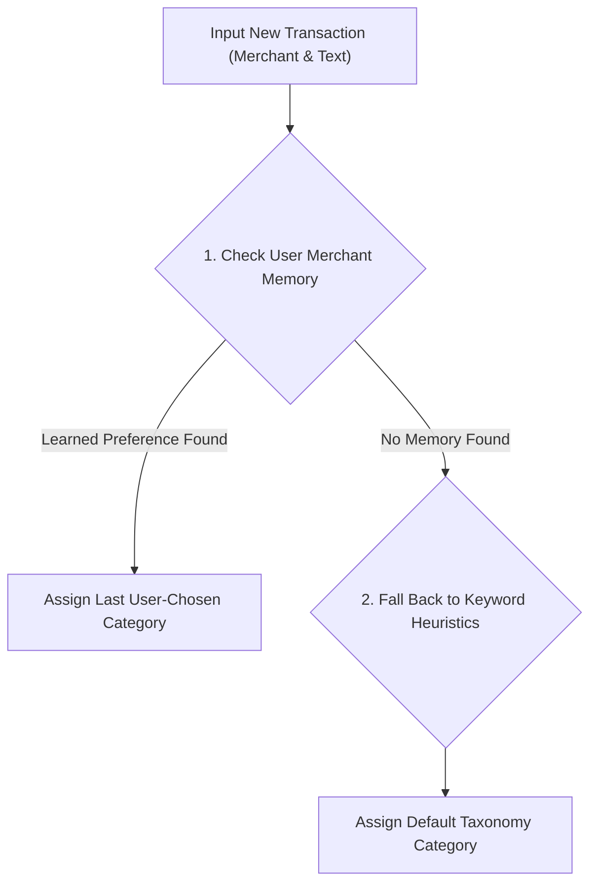

# Dedicated Category Memory & Assignment Agent Skill

## Overview
This skill equips AI agents and subagents with the domain rules, category classification taxonomies, merchant preference learning mechanisms, and automated test protocols required to audit transaction category assignment in `ExpenseTrackerApp`.

## Capabilities & Responsibilities

1. **User Repeat Preference Learning Memory**:
   - When a user manually assigns or edits a category for any merchant (e.g. changing `Swiggy` -> `Late Night Snacks`), the system immediately records `(merchantPattern -> assignedCategory)` in `MerchantCategoryMappingEntity`.
   - On future repeated transactions from the same merchant (e.g. subsequent `Swiggy` SMS or notification), `CategoryClassifier` checks the learned memory **first**, overriding general defaults to assign the user's **exact last chosen category**.

2. **In-Place Category Editing & Historical Sync**:
   - System default categories and custom categories are seeded into Room database table `categories`.
   - Editing any category performs a true SQL `UPDATE` in Room (`updateCategoryInPlace`), preserving the category primary key `id` and eliminating duplicate category creation.
   - Renaming a category automatically updates all past historical transactions matching the old category name in Room (`updateTransactionCategoryName`).

3. **Fallback Taxonomy Heuristics**:
   - Standard 18-category taxonomy (`Food & Dining`, `Groceries & Vegetables`, `Transportation`, `Fuel`, `Bills & Utilities`, `Subscriptions`, `Investments`, `Shopping`, `Health & Medical`, `Insurance`, `Government & Fees`, `Rent`, `EMI`, `Income`, `Transfer`, `General Expense`).

## Automated Execution & Verification Checklist



## Verification Command
```powershell
cmd /c gradlew.bat testDebugUnitTest
```
