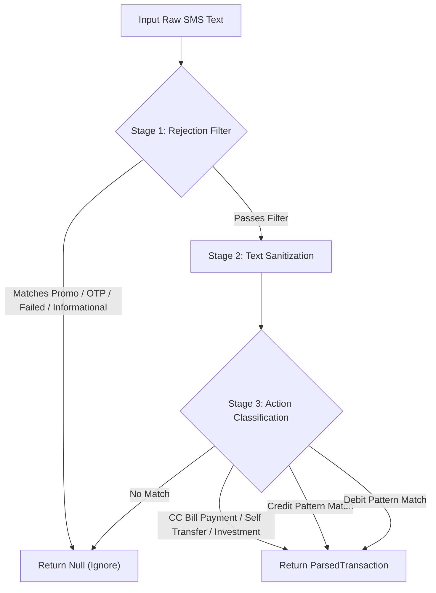

# Dedicated SMS Transaction Parser Agent Skill

## Overview
This skill equips AI agents and subagents with the domain rules, test vectors, regex pattern safety standards, and evaluation protocols required to audit and enhance financial SMS parsing in `ExpenseTrackerApp`.

## Capabilities & Responsibilities

1. **False Positive Prevention & Noise Rejection**:
   - Differentiate actual completed financial transactions (Debits, Credits, Transfers, Investments) from marketing offers, loan approvals, festive promos, EMI conversion prompts, e-mandates, and OTPs.
   - Reject promotional loan phrases: `festive offer`, `festive loan`, `digital authorization`, `is 1 step away`, `convert your transaction`, `no paperwork needed`, `pre-approved credit`, `apply via link`.

2. **Regex Word Boundary Safety**:
   - Enforce exact word boundaries (`\b`) on short keyword matchers (e.g. `\bcred\b` instead of substring matching `" to cred"`, which collides with `"to credit"`).
   - Ensure amount extraction ignores pre-approved limits, current outstanding balances, and total credit limits.

3. **Merchant & Category Classification**:
   - Standardize merchant extraction for UPI VPAs (`@ybl`, `@okaxis`, `@paytm`, `@icici`).
   - Categorize payments accurately into `Food & Dining`, `Bills & Utilities`, `Shopping`, `Transportation`, `Investments`, `Income`, `Insurance`, `Government & Fees`.

4. **Continuous Quality & Test Suite Auditing**:
   - Every modified parser pattern MUST be backed by a corresponding unit test in `RegexTransactionParserTest.kt`.
   - Maintain 100% pass rate across all historical test vectors.

## Execution Checklist for Parser Auditing



## Running Automated Verification
To verify all parser rules and test vectors:
```powershell
cmd /c gradlew.bat testDebugUnitTest --tests "com.expensetracker.app.ingestion.parser.RegexTransactionParserTest"
```
