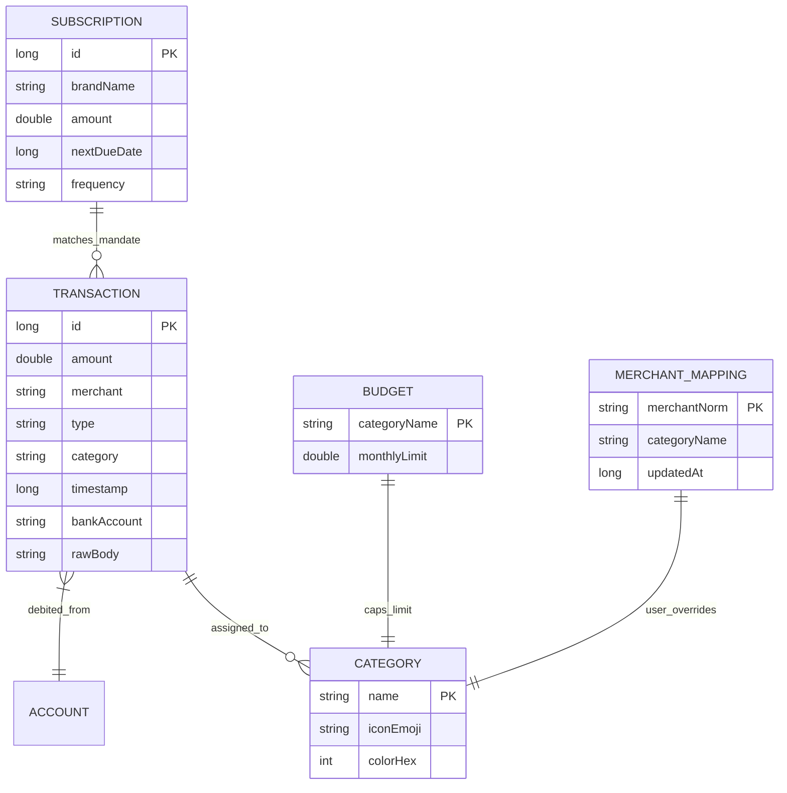

# 🏛️ Platform Architecture — Expense Tracker App

```mermaid
graph TD
    subgraph Ingestion["1. Ingestion Layer (Background)"]
        SMS[SmsReceiver] -->|SMS PDU| Parser[RegexTransactionParser]
        Notif[ExpenseNotificationListenerService] -->|Push Bundle| Parser
        Scanner[SmsScanner (Incremental)] -->|Cursor Batch| Parser
        Parser --> Filter{Noise Filter & Word Boundary Check}
        Filter -->|Valid Financial Tx| Classifier[CategoryClassifier & Memory]
    end

    subgraph DataLayer["2. Data & Domain Layer (Clean Architecture)"]
        Classifier --> Repo[TransactionRepository]
        Repo --> DB[(ExpenseDatabase: SQLCipher AES-256)]
        DB --- Entities["Entities: Transaction, Category, Budget, Subscription, MerchantMapping"]
    end

    subgraph Presentation["3. Presentation Layer (Jetpack Compose M3)"]
        Repo -->|Flows / State| ViewModels["ViewModels: Dashboard, Transactions, Budgets, Analytics"]
        ViewModels --> UI["UI Screens: M3 Compose, Dark/Light Themes, Animated Progress"]
    end

    subgraph Security["4. Security & Privacy Layer"]
        Keystore[Android KeyStore] -->|Derives Key| DB
        Bio[BiometricLockManager] -->|Gates App Access| UI
        ZeroNet[Zero Internet Permission] -.->|Enforces 100% Offline| Ingestion
    end
```

### Entity Relationship Diagram (ERD)


